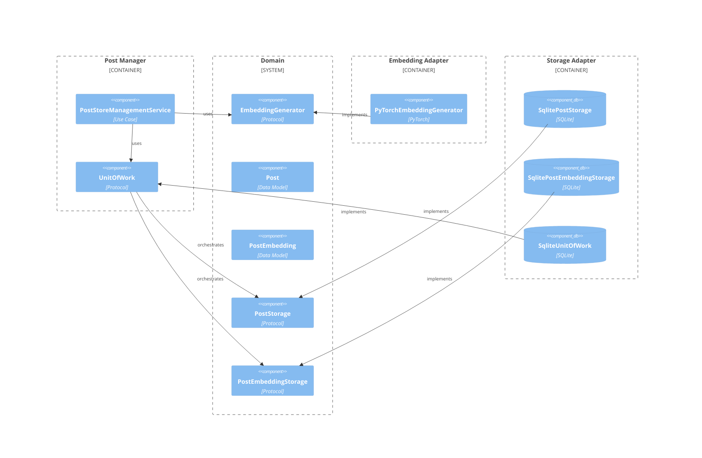
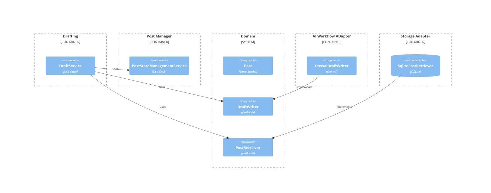
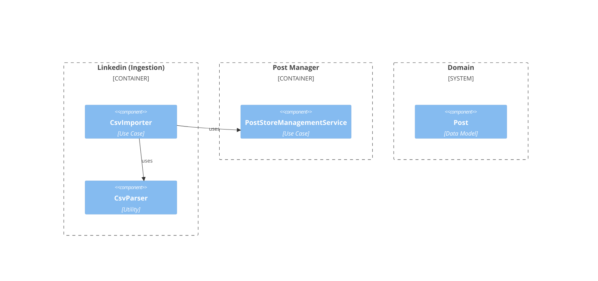
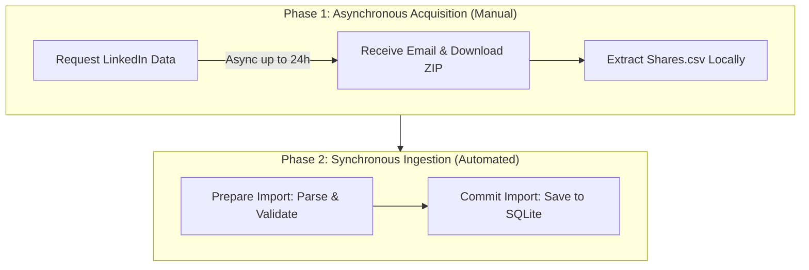

# LinkedIn Idea to Post

## Architecture

### Post Management Components

The Use Case for correctly managing `Post`.

- `PostStoreManagementService` is the component for saving `Post` objects, ensuring that the corresponding
  `PostEmbedding` object is generated and stored along atomically.

### Drafting Components

The Use Case for drafting a `Post` with an AI Writer.

- `DraftService` orchestrates `Post` retrieval to build the right context for the `DraftWriter` (i.e.
  `CrewaiDraftWriter`), and to correctly save it via `PostStoreManagementService`.

### Importing Components

The Use Case for ingesting `Post` objects from the `Shares.csv` file, downloaded
from [LinkedIn's data export page](https://www.linkedin.com/mypreferences/d/download-my-data).

- `CsvImporter` orchestrates the parsing of a `Shares.csv` file with `CsvParser`, the mapping to `Post` objects and the
  correctly save it via `PostStoreManagementService`.

_Note: visualize it on  [mermaid.ai](https://mermaid.ai/live) if the Markdown render doesn't work._

## Operational Flows

### Drafting a post from an idea

Prompting the "idea" message to the [`DraftService`](use_case/drafting/draft_service.py) to generate a draft of a
LinkedIn [
`Post`](domain/post.py).

### Importing posts from ~~LinkedIn~~

~~~~
Downloading the LinkedIn data from [download-my-data](https://www.linkedin.com/mypreferences/d/download-my-data) and
importing the Shares.csv file with [`CsvImporter`](linkedin/csv_importer.py).

