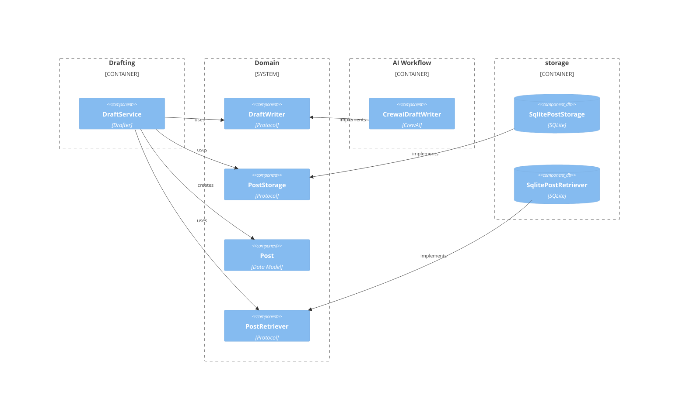
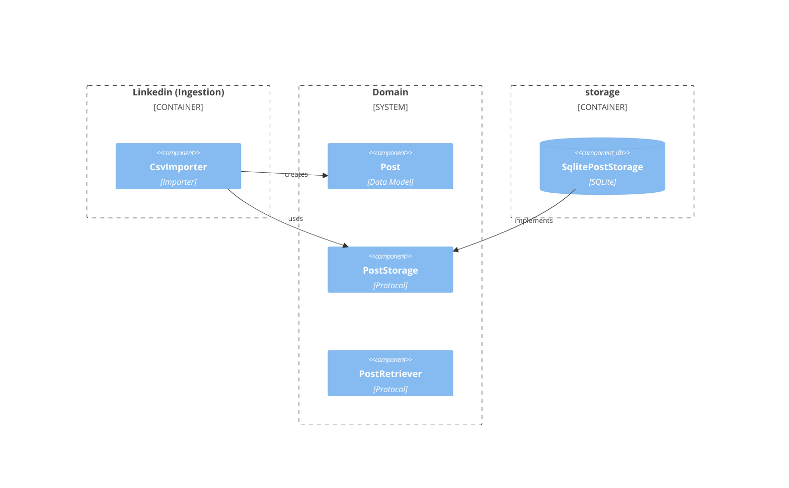
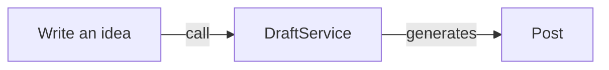
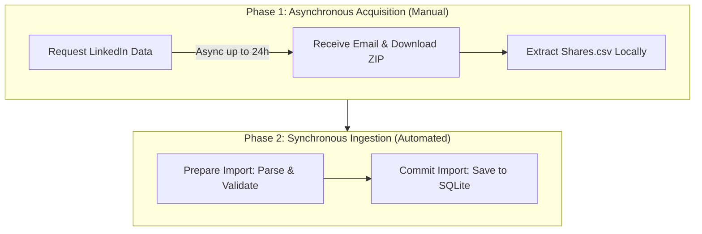

# LinkedIn Idea to Post

## Architecture

### Drafting Components

### Importing Components

_Note: visualize it on  [mermaid.ai](https://mermaid.ai/live) if the Markdown render doesn't work._

## Operational Flows

### Drafting a post from an idea

Prompting the "idea" message to the [`DraftService`](drafting/draft_service.py) to generate a draft of a LinkedIn [
`Post`](domain/post.py).

### Importing posts from ~~LinkedIn~~

~~~~
Downloading the LinkedIn data from [download-my-data](https://www.linkedin.com/mypreferences/d/download-my-data) and
importing the Shares.csv file with [`CsvImporter`](linkedin/csv_importer.py).

