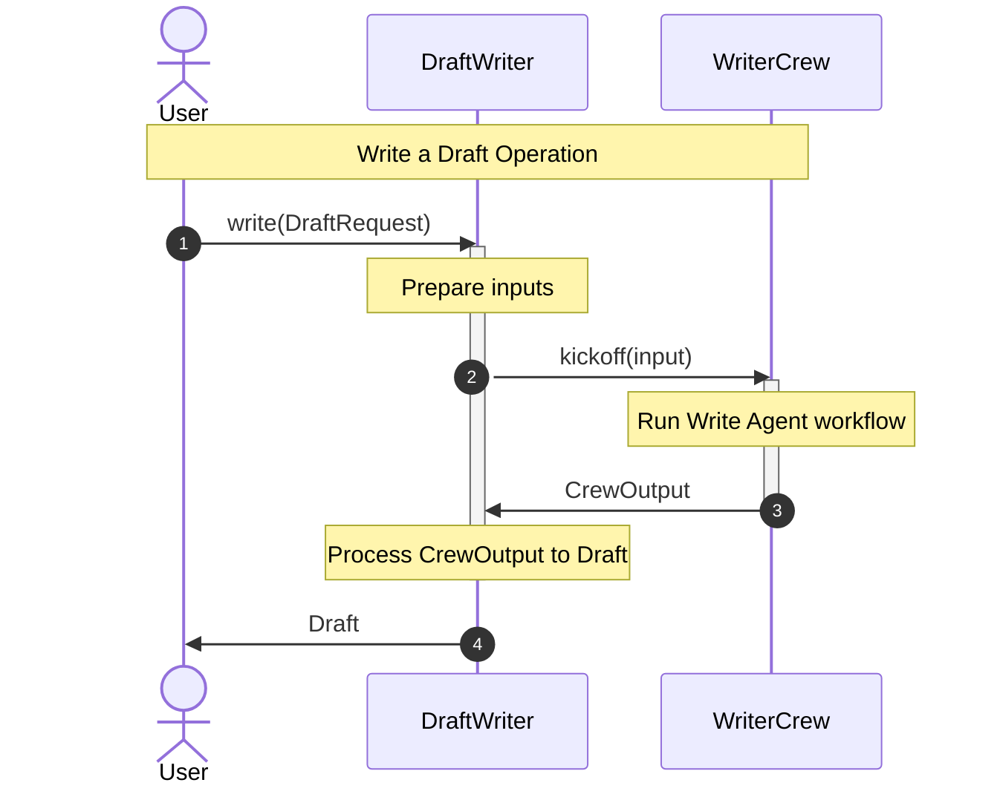

# LinkedIn Idea to Post – AI Workflow

This directory contains the AI workflow implementation responsible for generating a post draft from the user's idea.

The main class is [`CrewaiDraftWriter`](crewai_draft_writer.py), which implements the `DraftWriter` contract by
preparing
the workflow inputs, invoking the `WriterCrew`, and transforming its output into a Draft.

## AI Workflow Sequence Diagrams

### Writer Sequence Diagram

## Main Components

### The [CrewaiDraftWriter](crewai_draft_writer.py)

The `CrewaiDraftWriter` class implements the `DraftWriter` contract using CrewAI to execute the writing workflow.

| Method                                  | Description                                                                                       |
|-----------------------------------------|---------------------------------------------------------------------------------------------------|
| `write(request: DraftRequest) -> Draft` | Formats the voice examples, invokes the `WriterCrew`, and converts its raw output into a `Draft`. |

The writer receives an LLM instance through its constructor and passes it to the crew.

#### The [llm_factory.py](llm_factory.py)

The `build_llm` factory method builds a `BaseLLM` based on the `LlmSettings` from [config.py](../config.py).
A custom `PromptEchoLLM` class, which extends `BaseLLM`, is provided as an 'offline' option, useful for development and
debugging what prompts would be sent to an 'online' LLM.

### The [WriterCrew](writer_crew.py)

The `WriterCrew` class defines and orchestrates the CrewAI agents and tasks responsible for generating the post.

- **Agent:** Configures the writer agent with the injected LLM.
- **Task:** Defines the `write_post` task assigned to the writer agent.
- **Process:** Executes the workflow sequentially.

The crew configuration is loaded from YAML files:

1. [agents.yaml](config/agents.yaml): the agents participating in the workflow, including their roles, goals, and
   backstories.

2. [tasks.yaml](config/tasks.yaml): the tasks assigned to the agents, including their descriptions and expected outputs.

### External Boundaries

1. [DraftWriter](../domain/drafting.py) (from domain): the contract for generating a `Draft` from a `DraftRequest`.
2. [DraftRequest](../domain/drafting.py) and [Draft](../domain/drafting.py) (from domain): the input and output models
   defining the boundary of the drafting workflow.
3. **CrewAI:** the framework used to define agents, tasks, and their execution.
4. **LLM:** injected into `CrewaiDraftWriter` and passed to the `WriterCrew` to power the writing agent.