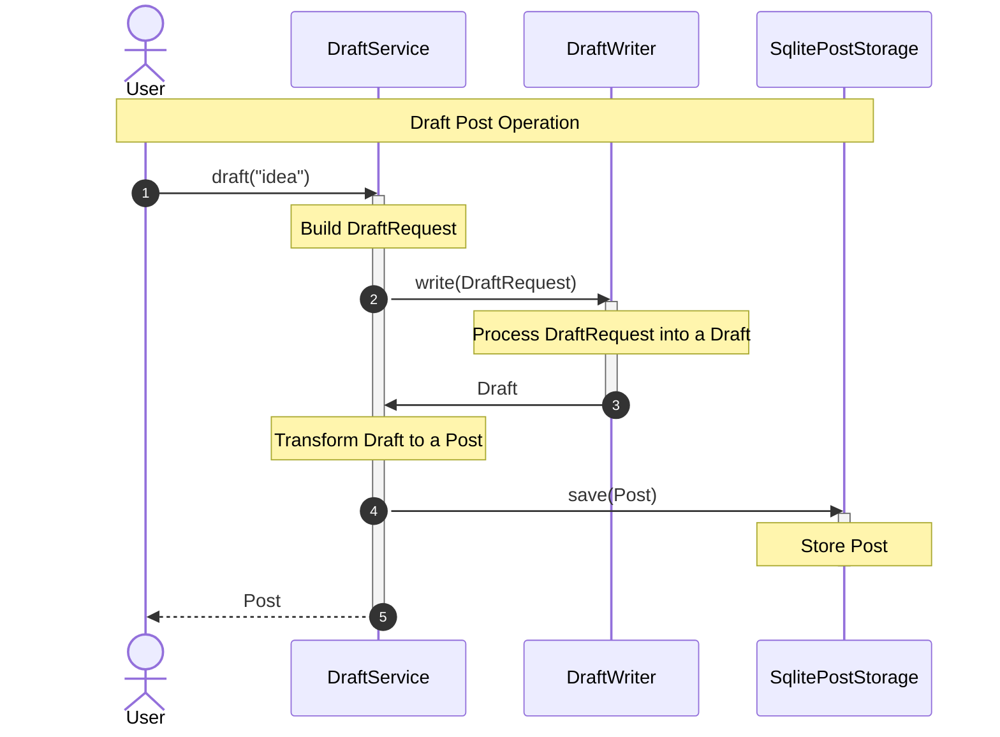

# LinkedIn Idea to Post – Drafting

This directory contains the orchestration logic for drafting a post from the user's idea, by preparing the context for
the AI workflow and managing the Post creation and storage.

The main class is [DraftService](draft_service.py) which orchestrates the `DraftWriter` in order to create a Post and
store it in the app's storage.

## Drafting Sequence Diagram

## Main Components

### The [DraftService](draft_service.py)

The `DraftService` class, which orchestrate the drafting process of a `Post` from an 'idea'.

| Method                     | Description                                                                                                   |
|----------------------------|---------------------------------------------------------------------------------------------------------------|
| `draft(idea: str) -> Post` | Builds the knowledge for the `DraftWriter` and invokes it to generate a `Draft` and transform it to a `Post`. |

### External Boundaries

1. [DraftWriter](../domain/drafting.py) (from domain): the contract for the drafting logic, which transforms an 'idea'
   into a `Post`.
    - [CrewaiDraftWriter](../ai_workflow/crewai_draft_writer.py) (from ai_workflow): the agentic implementation of
      `DraftWriter` contract.
2. [Post](../domain/post.py) (from domain): the core entity across the application, created by the drafting process and
   stored in via the persistence layer.
3. [SqlitePostStorage](../persistence/sqlite_post_storage.py) (from persistence): the application's persistence layer.
