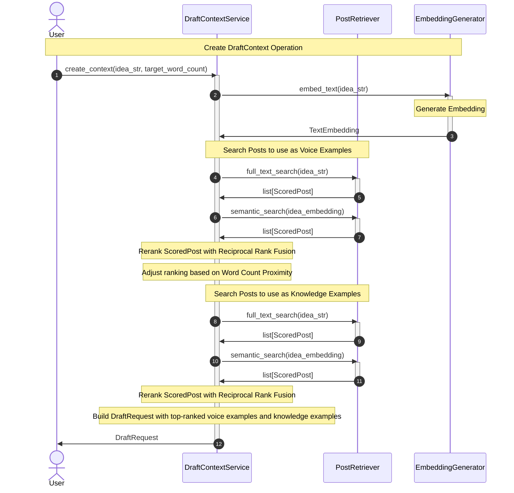
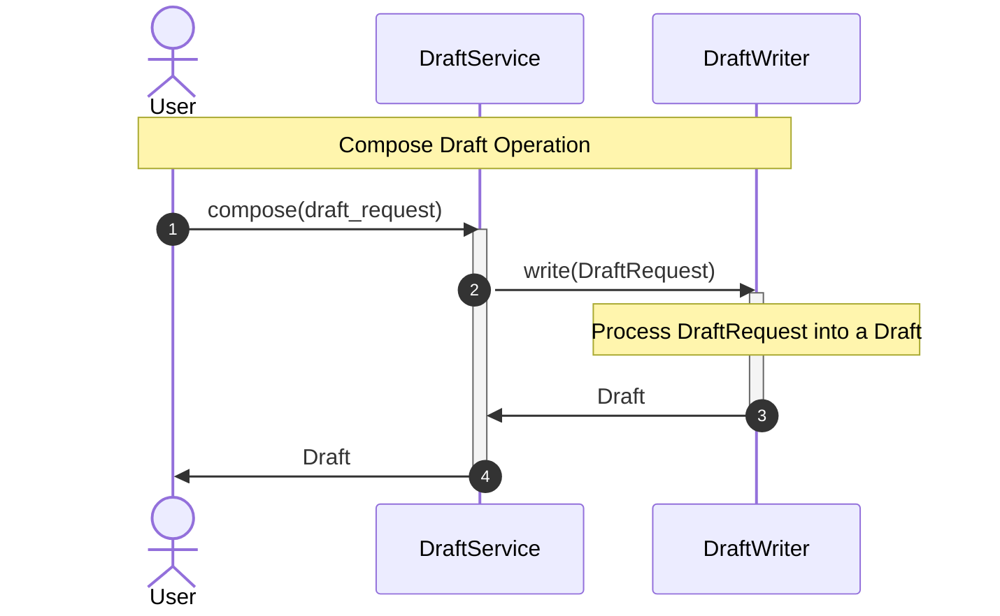

# LinkedIn Idea to Post – Drafting

This directory contains the orchestration logic for drafting a post from the user's idea, by preparing the context for
the AI workflow and managing the Post creation and storage.

The main class is [DraftService](draft_service.py) which orchestrates the `DraftWriter` in order to create a Post and
store it in the app's storage.

## DraftContext Creation Sequence Diagram

## Drafting Sequence Diagram

## Main Components

### The [DraftContextService](draft_context_service.py)

The `DraftContextService` class, takes care of retrieving and ranking the most appropriate `Post` objects for building a
`DraftContext`. It orchestrates `PostRetriever` searches and re-ranking algorithms.

| Method                                                              | Description                                                                                                                       |
|---------------------------------------------------------------------|-----------------------------------------------------------------------------------------------------------------------------------|
| `create_context(idea: str, target_word_count: int) -> DraftContext` | Builds a `DraftContext` by retrieving appropriate `Post` objects via Full-Text Search Semantic Search, and Re-Ranking algorithms. |

### The [DraftService](draft_service.py)

The `DraftService` class, which orchestrate the drafting process of a `Post` from an 'idea' string and a `DraftContext.

| Method                     | Description                                                                                                   |
|----------------------------|---------------------------------------------------------------------------------------------------------------|
| `draft(idea: str) -> Post` | Builds the knowledge for the `DraftWriter` and invokes it to generate a `Draft` and transform it to a `Post`. |

### [ranking.py](ranking.py)

Provides pure functions for Re-Ranking `ScoredPost` based on more restrictive criteria:

| Function                                                                                                                                                     | Description                                                                                                                                                                                                |
|--------------------------------------------------------------------------------------------------------------------------------------------------------------|------------------------------------------------------------------------------------------------------------------------------------------------------------------------------------------------------------|
| `reciprocal_rank_fusion(semantic_ranked_posts: list[UUID], fts_ranked_posts: list[UUID],, *) -> list[tupe[UUID,float]]`                                      | Implemets [Reciprocal Rank Fusion (RRF)](https://hyper.ai/en/wiki/29130) to re-rank posts by combining their both the Tull-Text rank and the Semantic rank, with a default preference for semantic scores. |
| `rerank_by_word_count_proximity(scored_ids: list[tuple[UUID, float]], word_count_by_id: dict[UUID, int],target_word_count: int) -> list[tuple[UUID, float]]` | Implements a "normalization" of existing scores based on the proximity of to the tardget word count: the closer the better the score is adjusted.                                                          |

### External Boundaries

1. [Post](../../domain/post.py) (from domain): the core entity across the application, created by the drafting process
   and stored in via the persistence layer.
    - [ScoredPost](../../domain/post.py): a `Post` with the score relative to the search strategy used for retrieval.
2. [PostRetriever](../../domain/retrieval.py) (from domain): the protocol for advanced searches, i.e. full-text or
   semantic, of `ScoredPost` objects.
3. [PostStoreManagementService](../post_management/post_post_management_service.py) (from use case): the service for
   atomically writing `Post` objects with their auto-generated `PostEmbedding` to storage.
4. [DraftWriter](../../domain/drafting.py) (from domain): the protocol for the drafting logic, which transforms an '
   idea' into a `Post`.
    - [CrewaiDraftWriter](../../adapters/ai_workflow/crewai_draft_writer.py) (from ai_workflow): the agentic
      implementation of `DraftWriter` contract.