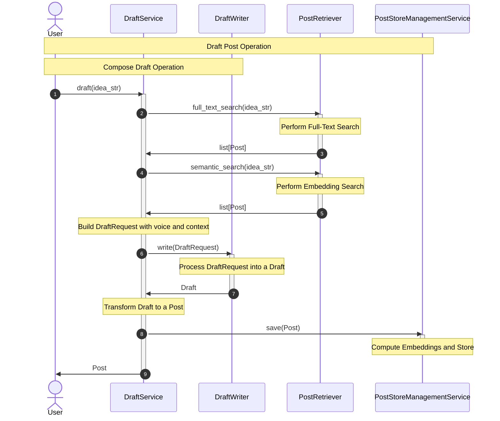

# LinkedIn Idea to Post – Drafting

This directory contains the orchestration logic for drafting a post from the user's idea, by preparing the context for
the AI workflow and managing the Post creation and storage.

The main class is [DraftService](draft_service.py) which orchestrates the `DraftWriter` in order to create a Post and
store it in the app's storage.

## Drafting Sequence Diagram

## Main Components

### The [DraftService](draft_service.py)

The `DraftService` class, which orchestrate the drafting process of a `Post` from an 'idea'.

| Method                     | Description                                                                                                   |
|----------------------------|---------------------------------------------------------------------------------------------------------------|
| `draft(idea: str) -> Post` | Builds the knowledge for the `DraftWriter` and invokes it to generate a `Draft` and transform it to a `Post`. |

### External Boundaries

1. [Post](../../domain/post.py) (from domain): the core entity across the application, created by the drafting process
   and stored in via the persistence layer.
    - [ScoredPost](../../domain/post.py): a `Post` with the score relative to the search strategy used for retrieval.
2. [PostRetriever](../../domain/retrieval.py) (from domain): the protocol for advanced searches, i.e. full-text or
   semantic, of `ScoredPost` objects.
3. [PostStoreManagementService](../post_management/post_post_management_service.py) (from use case): the service for
   atomically writing `Post` objects with their auto-generated `PostEmbedding` to storage.
4. [DraftWriter](../../domain/drafting.py) (from domain): the protocol for the drafting logic, which transforms an '
   idea' into a `Post`.
    - [CrewaiDraftWriter](../../adapters/ai_workflow/crewai_draft_writer.py) (from ai_workflow): the agentic
      implementation of `DraftWriter` contract.