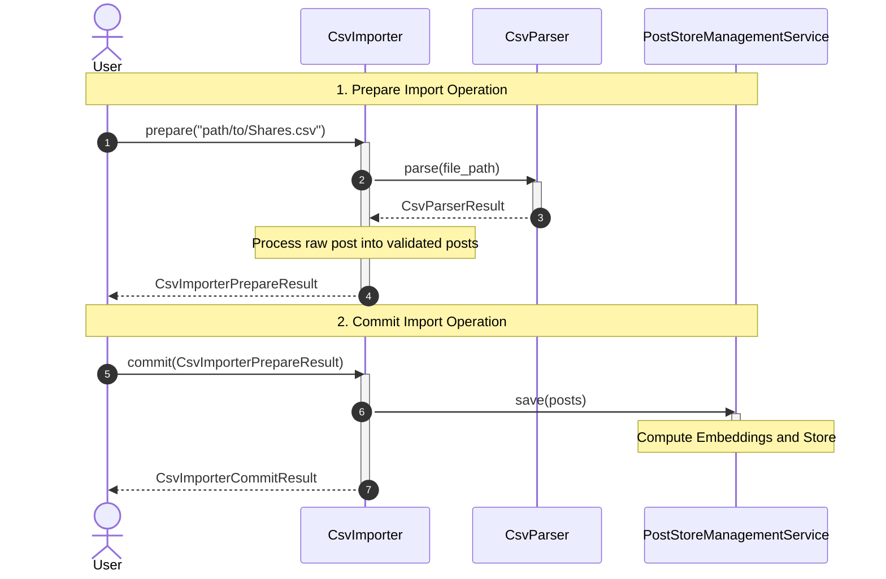

# LinkedIn Idea to Post - LinkedIn Ingestion

This directory contains the LinkedIn-specific components and logic for importing LinkedIn posts into the application.

The main class is [CsvImporter](csv_importer.py) which imports the LinkedIn's `Shares.csv` file into the app's storage.

## Import Sequence Diagram

## Main Components

### The [Data Model](model.py)

The data models used throughout CSV parsing and importing process.

| Model               | Description                                                                                                                                                                                                   |
|---------------------|---------------------------------------------------------------------------------------------------------------------------------------------------------------------------------------------------------------|
| `RawPost`           | Represents a raw post extracted from LinkedIn's `Shares.csv` file, downloaded from [LinkedIn's data export page](https://www.linkedin.com/mypreferences/d/download-my-data).                                  |
| `CsvParserResult`   | Represents the CSV parsing result, containing a list of `RawPost` objects and a list of `CsvParsingError` objects (structured parsing errors propagated to the user).                                         |
| `CsvImporterResult` | Defines the contract across the importing boundary, containing a list of `Post` objects from the [domain](../../domain) module, a list of `CsvParsingError` objects, and a list of `CsvMappingError` objects. |

### The [CsvImporter](csv_importer.py)

The `CsvImporter` class, responsible for importing LinkedIn posts into the application's storage, as `Post` objects.

| Method                                                                        | Description                                                                                                                             |
|-------------------------------------------------------------------------------|-----------------------------------------------------------------------------------------------------------------------------------------|
| `prepare(file_path: Path) -> CsvImporterPrepareResult`                        | Parses the csv file with `CsvImporter` and maps the `RawPost` objects to `Post` objects, while collecting mapping errors along the way. |
| `commit(prepare_result: CsvImporterPrepareResult) -> CsvImporterCommitResult` | Stores `Post` objects using `SqlitePostStorage` by ignoring eventual parsing and mappin errors which happened during prepare.           |

#### The [CsvParser](csv_parser.py)

The `CsvParser` class, responsible for reading and parsing the `Shares.csv` file into `RawPost` obejcts.

| Method                                      | Description                                                                         |
|---------------------------------------------|-------------------------------------------------------------------------------------|
| `parse(file_path: Path) -> CsvParserResult` | Parses the csv file to `RawPost` objects and collects parsing errors along the way. |

### External Boundaries

1. [Post](../../domain/post.py) (from domain): the core entity across the application, created by the import process and
   stored in via the persistence layer.
2. [PostStoreManagementService](../post_management/post_post_management_service.py) (from use case): the service for
   atomically writing `Post` objects with their auto-generated `PostEmbedding` to storage.
