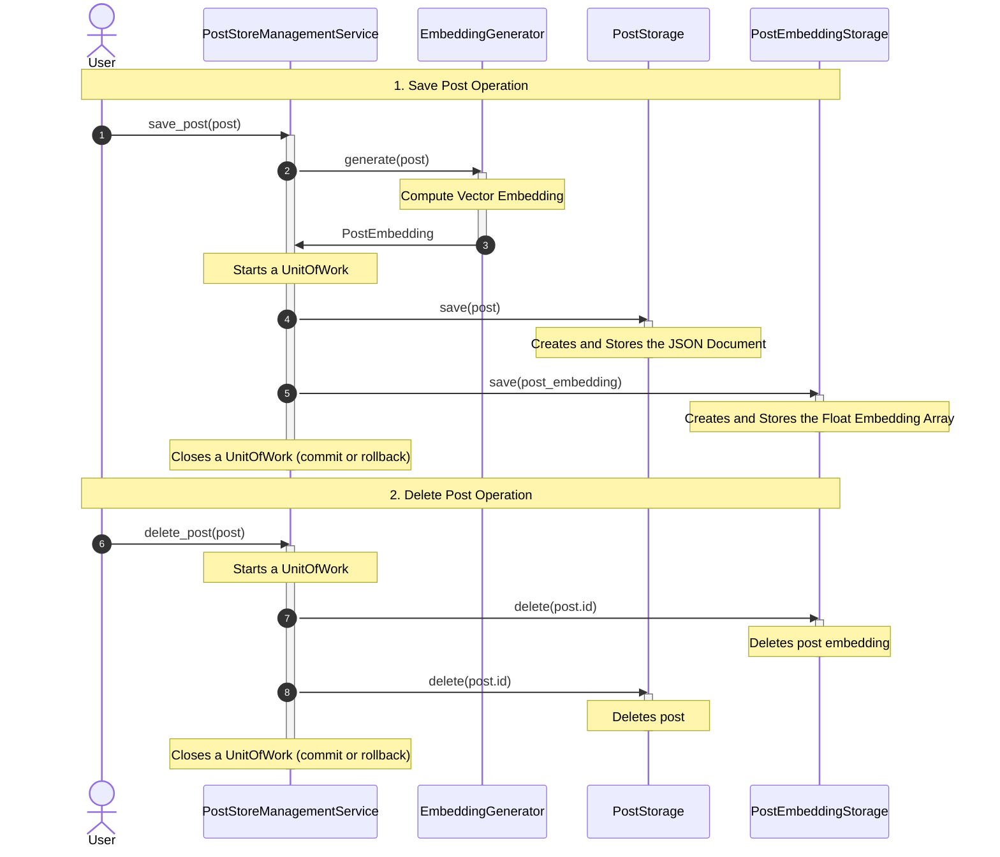

# LinkedIn Idea to Post – Post Management

This directory contains the orchestration logic for coordinating writes across `PostStorage` and `PostEmbeddingStorage`
as atomic operations by leveraging the **Unit of Work** pattern.

The main components are the `UnitOfWork` protocol (context manager contract for transaction boundaries) and
[PostStoreManagementService](post_post_management_service.py), which coordinates embedding generation and keeps `posts`
and `post_embeddings` consistent as a single unit of work.

## Post Store Sequence Diagram

## Main Components

### The `UnitOfWork` Protocol

Defines the context manager contract (`__enter__` and `__exit__`) used in `with` blocks to group statements into an
all-or-nothing transaction: committing when the block exits cleanly, and rolling back if an exception is raised.

| Method / Hook                                | Description                                                                                            |
|----------------------------------------------|--------------------------------------------------------------------------------------------------------|
| `__enter__() -> Self`                        | Enters the transaction context and returns the context manager instance for use in a `with` statement. |
| `__exit__(exc_type, exc_val, exc_tb) -> bool | None`                                                                                                  | Commits if no exception occurred (`exc_type is None`), or rolls back and lets exceptions propagate. |

### The [PostStoreManagementService](https://www.google.com/search?q=post_write_management_service.py)

The `PostStoreManagementService` class coordinates multi-table writes across `PostStorage` and `PostEmbeddingStorage`
within a `UnitOfWork` so partial updates are never left behind on failure. Storage implementations execute statements
directly without opening their own commit/rollback boundaries.

| Method                          | Description                                                                                              |
|---------------------------------|----------------------------------------------------------------------------------------------------------|
| `save_post(post: Post) -> None` | Generates a `PostEmbedding` for `post` and saves both `post` and `post_embedding` inside `unit_of_work`. |
| `delete_post(post_id: UUID)`    | Deletes the embedding and post for `post_id` atomically inside `unit_of_work`.                           |

## External Boundaries

1. [Post](../../domain/post.py) (from domain): the core entity across the application, created by the import process and
   stored in via the persistence layer.
2. [PostStorage](../../domain/storage.py) (from domain): the persistence protocol for CRUD operations on `Post`.
3. [EmbeddingGenerator](../../domain/embedding.py) (from domain): the embedding protocol
4. [PostEmbeddingStorage](../../domain/storage.py) (from domain): the persistence protocol for CRUD operations on
   `PostEmbedding`.

